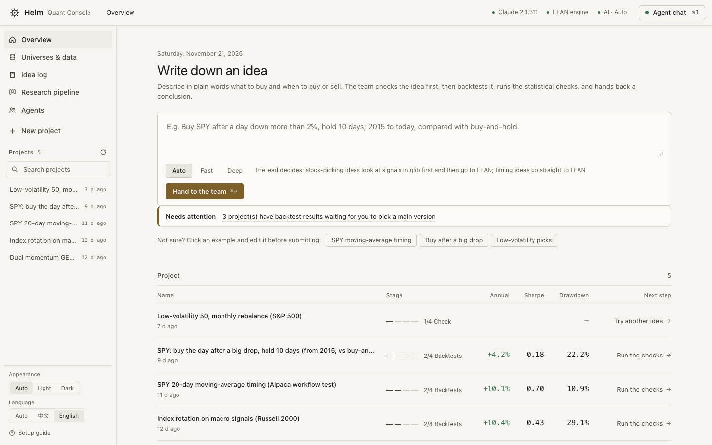

# Helm: a local quant research console

> English | [中文（以中文版为准）](README.md) · The web UI is in English and Chinese; agent prompts and code comments are in Chinese.

Helm turns a plain-language trading idea into a tested strategy, on your own Mac. Claude Code agents write a rules spec, then QuantConnect LEAN code, backtest it on a locally built LEAN engine, run statistical checks and paper trading, and explain the results in a local web page.

It is built to make research **harder to fool yourself with**: every idea and parameter set is counted, the holdout period is logged, and a strategy must pass a statistical gate (adjusted for the number of trials) before it can become the main version.



**Status:** early (v1, November 2026). Tested on Apple Silicon Macs. Some paths have so far only been tested with stand-ins (see [docs/ROADMAP.md](docs/ROADMAP.md)).

**Not investment advice. Helm cannot place real orders.** The only broker link is Alpaca *paper* trading, hard-wired to `paper-api.alpaca.markets`. Backtests use free adjusted daily prices and say little about future returns.

## Install

macOS only. Paste into Terminal:

```
curl -fsSL https://raw.githubusercontent.com/zhuhroscar-tech/helm/main/install.sh | bash
```

It checks your Mac, offers to install Node and Claude Code if they're missing, downloads Helm to `~/Helm`, installs the engine (.NET 10, Python 3.11, LEAN), offers to build the Mac app, and opens Helm. It asks before each change and never uses sudo. Run it again to update. To read it first: download `install.sh`, then `bash install.sh`.

Manual install, same result:

```
git clone https://github.com/zhuhroscar-tech/helm.git && cd helm
scripts/setup.sh --check   # what's missing, changes nothing
scripts/setup.sh           # install it
npm start                  # open http://localhost:4377
```

- **You need:** a Mac (Apple Silicon tested, Intel untested), Node 20+, Git, Claude Code, and 2–3 GB of disk. The first install takes 15–30 minutes.
- **Cost:** Helm is free (MIT). The agents need a model: a Claude subscription (Pro / Max / Team), an Anthropic API key, or an Anthropic-compatible API (DeepSeek, Kimi, GLM, OpenRouter…). A research deck costs about USD 0.50. Choose under **AI** in the top bar ([setup details](docs/CONFIGURATION.md#connecting-an-ai)).
- **Optional:** qlib + LightGBM for full Qlib research; LibreOffice for PDF decks; an Alpaca paper account.
- **Help:** [docs/GETTING-STARTED.md](docs/GETTING-STARTED.md) (fresh Mac to first backtest) · `npm run doctor` · [docs/FAQ.md](docs/FAQ.md) · [docs/CONFIGURATION.md](docs/CONFIGURATION.md) · Mac app: [docs/MACOS-APP.md](docs/MACOS-APP.md)

## How a strategy moves through Helm

Each project shows four stages: **idea test → backtest → statistical check → paper trading**.

1. **Idea test** (stock-selection ideas). Your idea becomes 1–3 factor formulas with a stated direction, tested on the **development period only** over point-in-time index members. You get IC with Newey-West t-values, quintile returns after costs, year-by-year stability, and overlap with known factors, ending in signal / weak signal / no signal. Every formula is logged, so trying more raises the bar. "No signal" ends the idea.
2. **Spec, then code.** The orchestrator writes `spec.md` (universe, entries and exits, sizing, rebalancing, costs, benchmark, dev/holdout dates) before any code. The engineer's LEAN code must match it.
3. **Backtest** on local LEAN, in the background. Each run keeps a code snapshot, results, logs and a data/code fingerprint, plus a role (`main`, `candidate`, `ablation`, …) and a period (`dev`, `holdout`, `full`). You can compare 2–4 runs side by side.
4. **Statistical check** (`validate_backtest`):
   - the metrics must be self-consistent;
   - the lower bound of the Sharpe 95% confidence interval must be above 0;
   - at least 90% confidence of beating the benchmark;
   - deflated Sharpe ≥ 95%, adjusted for all trials;
   - at least one year of data.

   Only a passing run can be made `main` by an agent. Holdout runs are logged, and from the second one on Helm warns that the holdout is no longer clean.
5. **Robustness and tuning:**
   - Segment, cost-stress and market-regime breakdowns from saved results.
   - Parameter sensitivity (×0.8 / ×1.2).
   - Factor attribution: how much of the return is just market, size, value, profitability, investment or momentum exposure (Fama-French factors from the Kenneth R. French Data Library), and whether anything is left over (alpha). Read-only; adds no trials.
   - Latin-hypercube tuning that recommends the centre of a parameter plateau, not the single best point, and estimates the probability of backtest overfitting (PBO). Every candidate counts as a trial.
6. **Paper trading.** Freeze a backtest and Helm re-runs it after each US trading day, so results after the freeze date are truly out-of-sample.
   - Two modes: internal simulation, or an Alpaca paper account.
   - Alpaca mode trades only positions that session itself opened, only from a `main` version, and never on a day with stale data.
   - A panel compares live results with what the backtest predicted.

## Other features

- **Add a layer.** On an existing strategy (say, ETF momentum), choose from colour blocks:
  - qlib stock picking for its US index ETF (an agent proposes the options);
  - a qlib timing filter: market breadth from point-in-time S&P 500 members (share above their 200-day average and similar) confirms when to hold the stock leg, after an honest time-series test (`HelmBreadth`);
  - volatility-based position sizing (`HelmVol`);
  - a fixed-weight mix with your other validated strategies, or, if you have none yet, building a low-correlation one;
  - "No layer".

  The intro shows the factor attribution first. Stock-picking layers often find no signal. When earlier idea tests found nothing, or the agent rates the outlook as weak, the other options come first, marked "Recommended". Whatever you pick runs as a candidate against the unchanged original; your main version and paper trading are not touched.
- **Qlib research.** For projects with no idea yet: scans Alpha158 and fundamental factors and trains LightGBM, with a single holdout check. Needs qlib.
- **Volatility targeting** (`HelmVol`). Scales position size by a forecast volatility using past data only. It aims to lower drawdowns, not to raise returns.
- **Send to QuantConnect.** Connect once with your QC User ID and API token. Helm creates a project in your account, uploads the code and compiles it in the cloud. It doesn't start cloud backtests or live trading. Strategies that read Helm's local data (`helm_data`) need changes to run on QC, and QC's unadjusted prices give somewhat different results.
- **Research decks.** Editable PowerPoint (PDF needs LibreOffice) for your team or clients. Every number is filled in from the backtest records, never typed by the model; client decks always show the holdout and the number of trials.
- **Idea journal and pipeline board.** One timeline of every idea test, backtest, holdout and paper run.

## What Helm will not do

- Agents never place or cancel orders. Only paper sessions you start on the page trade.
- A run that fails the statistical check can't become `main` or trade on Alpaca. "Almost passed" is not a pass.
- Results, trial counts, holdout logs and paper logs are append-only. Deleting a backtest doesn't lower the bar.
- No claim that a strategy works without engine output behind it. "No reliable strategy found" is a valid result.

## Data and limits

- **Prices:** Yahoo Finance adjusted daily bars for US stocks and ETFs, refreshed daily. No intraday data, options, futures, FX or crypto. Adjusted prices aren't the prices that actually traded, so rules based on absolute price levels are unreliable.
- **Universes:**
  - S&P 500 is point-in-time. After 2020 some delisted members have no free prices, which makes later results optimistic.
  - Nasdaq 100 history is partial.
  - Dow 30, semiconductors, S&P 100 and the Russell sample use today's lists only, so they carry survivorship bias.
- **Other data:** SEC fundamentals; FRED macro series (revised values, with publication lags applied); agent-built datasets from public sources, flagged as possibly incomplete.
- **Costs:** LEAN's default slippage is zero. Specs should state one.

## Security, briefly

- The server listens on 127.0.0.1 only. State-changing requests need a per-start page token and a same-origin check.
- Strategy code runs in a macOS `sandbox-exec` sandbox: no network, no home folder, no secrets. Without the sandbox, backtests refuse to run unless you explicitly turn it off (`HELM_EXEC_SANDBOX=off`).
- Keys (AI, Alpaca, QuantConnect) are stored locally with file mode 0600, are never sent back to the page, and agents can't read them.
- Agents' edits to Helm's own code go through an approval policy. Changes to research-rule code need your approval and are reverted automatically if tests fail.

Details: [SECURITY.md](SECURITY.md) · [docs/ARCHITECTURE.md](docs/ARCHITECTURE.md#safety-model) (also covers how the Chinese/English UI and translation work)

## Agents

Five agents (`agents.json`, editable) share the rules in `workspace/CLAUDE.md`:

| Agent | Does |
|---|---|
| Orchestrator (`mia`) | Writes the spec and hands each stage to a specialist; doesn't run backtests or write code itself |
| Researcher | Factor formulas, idea tests, qlib research |
| Engineer | LEAN code, compile fixes, backtests |
| Analyst | Statistical checks; judges whether a result can be trusted |
| Risk officer | Drawdown, exposure, extreme-market behaviour |

Hand-offs between agents appear as separate conversations. Stopping an agent also stops the agent it is waiting on.

## Repository

| Path | Contents |
|---|---|
| `server.mjs`, `public/` | Local server and web page (no npm dependencies, no CDN) |
| `mcp/qc-mcp.mjs` | Tools the agents use |
| `lib/` | Engine, statistics, tuning, paper trading, broker / QC clients, security policy |
| `engine/` | Data download, strategy data helpers (`helm_data.py`), lint, qlib research |
| `install.sh`, `scripts/setup.sh`, `macos/` | Installer, engine setup, Mac app |
| `projects/`, `data/` | Your projects and conversations (git-ignored) |

Tests: `npm test -- --fast` (no LEAN) or `npm test` (includes real LEAN backtests). Tests use temporary folders and don't touch your projects.

Agent behaviour evals: `npm run eval` runs 14 scenarios with the real claude and checks whether the agents follow the rules that only live in their prompts. Run it after changing a prompt or the model; it uses model usage. See [evals/README.md](evals/README.md) (Chinese).

[CONTRIBUTING.md](CONTRIBUTING.md) · [docs/ROADMAP.md](docs/ROADMAP.md) · [CHANGELOG.md](CHANGELOG.md) (Chinese) · [community/](community/README.md)

MIT licence. LEAN, yfinance and qlib are not part of this repository ([THIRD_PARTY_NOTICES.md](THIRD_PARTY_NOTICES.md)); Yahoo data is for personal use under Yahoo's terms.
