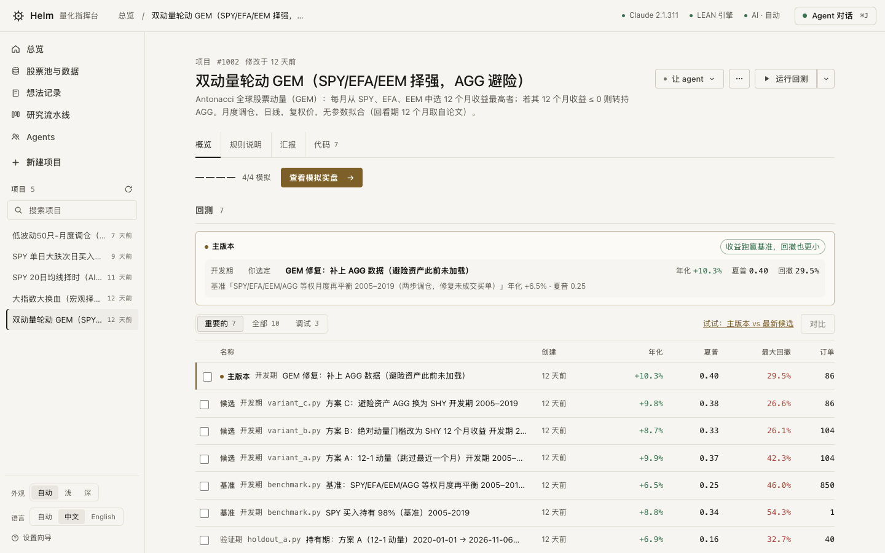

# Helm：本机量化研究台

> 中文（以本版为准）| [English](README.en.md) · 网页有中文和英文界面。

用大白话写一个交易想法，Helm 在你自己的 Mac 上把它变成经过检验的策略：Claude Code 智能体先写规则说明，再写 QuantConnect LEAN 代码，在本机编译好的 LEAN 引擎上回测，做统计检验和模拟实盘，并在本地网页里解释结果。

它的目的是让研究**更难自欺**：每个想法、每组参数都计数，验证期的使用有记录，策略必须通过统计门槛（按尝试次数校正）才能成为主版本。



**现状**：早期版本（v1，2026 年 11 月），在 Apple Silicon Mac 上测试过。有些路径目前只用替身测过（见 [docs/ROADMAP.md](docs/ROADMAP.md)）。

**不构成投资建议。Helm 不能下真实订单。** 唯一的券商接口是 Alpaca **模拟盘**，地址写死为 `paper-api.alpaca.markets`。回测用的是免费的复权日线，对未来收益说明不了多少。

## 安装

只支持 macOS。把下面这行粘贴到「终端」：

```
curl -fsSL https://raw.githubusercontent.com/zhuhroscar-tech/helm/main/install.sh | bash
```

它会检查这台 Mac；缺 Node、Claude Code 时提议安装；把 Helm 下载到 `~/Helm`，装好引擎（.NET 10、Python 3.11、LEAN），提议构建 Mac App，最后打开 Helm。每一步改动前都会先问，不用 sudo。再运行一次就是更新。想先看脚本：下载 `install.sh` 看过再 `bash install.sh`。

手动安装，效果一样：

```
git clone https://github.com/zhuhroscar-tech/helm.git && cd helm
scripts/setup.sh --check   # 列出缺什么，不做改动
scripts/setup.sh           # 安装
npm start                  # 打开 http://localhost:4377
```

- **需要**：Mac（Apple Silicon 测过，Intel 没测过）、Node 20+、Git、Claude Code、2–3 GB 硬盘。第一次安装 15–30 分钟。
- **费用**：Helm 免费（MIT）。智能体需要模型：Claude 订阅（Pro / Max / Team）、Anthropic API key，或兼容 Anthropic 接口的服务（DeepSeek、Kimi、GLM、OpenRouter 等）。一份研发汇报约 0.5 美元。在顶栏 **AI** 里选择（[详细说明](docs/CONFIGURATION.md#connecting-an-ai)）。
- **选装**：qlib + LightGBM（完整 Qlib 研究）、LibreOffice（汇报导出 PDF）、Alpaca 模拟账户。
- **帮助**：[上手指南](docs/GETTING-STARTED.zh.md)（从新 Mac 到第一个回测）· `npm run doctor` · [FAQ](docs/FAQ.md) · [配置](docs/CONFIGURATION.md) · [Mac App](docs/MACOS-APP.md)

## 一个策略在 Helm 里怎么走

每个项目都显示四步：**想法检验 → 回测 → 统计检验 → 模拟实盘**。

1. **想法检验**（选股类想法）。想法写成 1–3 个带方向的因子公式，**只用开发期**、在按历史成分股的指数里检验。结果包括 IC 和 Newey-West t 值、扣成本后的五分组收益、逐年稳定性、与已知因子的相关，结论是有信号 / 弱信号 / 没有信号。每个公式都记账，试得越多门槛越高；「没有信号」就结束这个想法。
2. **先规则，后代码。** 总控在写任何代码之前先写 `spec.md`（股票池、进出场、仓位、调仓、成本、基准、开发期和验证期），工程师写的 LEAN 代码必须和它一致。
3. **回测**：在本机 LEAN 上后台运行。每次回测保存代码快照、结果、日志、数据和代码指纹，带角色（`main`、`candidate`、`ablation` 等）和时期（`dev`、`holdout`、`full`）。可以 2–4 个并排对比。
4. **统计检验**（`validate_backtest`）：
   - 指标必须自洽；
   - 夏普 95% 置信区间下限要大于 0；
   - 跑赢基准的置信度至少 90%；
   - 按全部尝试次数校正的通缩夏普 ≥ 95%；
   - 至少一年数据。

   只有通过的回测才能被智能体设为 `main`。验证期回测有记录，从第二次起提示验证期已经不干净。
5. **稳健性和调参**：
   - 用已存结果做分段、成本压力和市场状态拆解。
   - 因子归因：收益里有多少只是市场、规模、价值、盈利、投资、动量这些已知因子的暴露（Fama-French 因子，来自 Kenneth R. French 数据库），扣掉后还剩多少（alpha）。只读，不计入尝试次数。
   - 拉丁超立方调参：推荐参数平台的中心而不是单个最好点，并估计回测过拟合概率（PBO）。每个候选都计入尝试次数。
6. **模拟实盘**：冻结一个回测，Helm 在每个美股交易日之后重跑，冻结日之后的结果是真正的样本外。
   - 两种模式：内部模拟，或 Alpaca 模拟账户。
   - Alpaca 模式只动这个模拟自己开的仓位，只用 `main` 版本，数据过期的那天不下单。
   - 有一块面板对比实际表现和回测的预期。

## 其他功能

- **叠加一层**：在已有策略（比如 ETF 动量）上，从色块里选一种：
  - 把美股指数 ETF 换成 qlib 选股（智能体给出方案）；
  - qlib 择时过滤：用标普 500 历史成分股算市场宽度（站上 200 日均线的比例等），先做一次时间序列检验，有信号才用来确认什么时候持有股票那条腿（`HelmBreadth`）；
  - 按波动率调仓位（`HelmVol`）；
  - 和你其他通过检验的策略按固定权重组合；还没有别的策略时，先做一个低相关的策略；
  - 不加这一层。

  开头先显示因子归因。选股层经常没有信号：之前的想法检验没有信号、或智能体判断前景弱时，不选股的方案排在前面并标「推荐」。你选的方案跑成候选，和原策略原样对照；主版本和模拟实盘不动。
- **Qlib 研究**：给还没有想法的空项目用。扫描 Alpha158 和基本面因子并训练 LightGBM，只看一次验证期。需要 qlib。
- **波动率目标**（`HelmVol`）：只用过去的数据预测波动率，并据此缩放仓位。目的是降低回撤，不是提高收益。
- **发到 QuantConnect**：用 QC 的 User ID 和 API token 连接一次，Helm 在你的账户里建项目、上传代码、云端编译。不开始云端回测，也不碰实盘。读 Helm 本地数据（`helm_data`）的策略要改过才能在 QC 上跑；QC 用未复权价格，结果会有些差别。
- **研发汇报**：生成可编辑的 PowerPoint（PDF 需要 LibreOffice），给团队或客户看。每个数字都从回测记录里填入，不由模型手写；给客户的版本一定写明验证期和尝试次数。
- **想法记录和研究流水线**：把每次想法检验、回测、验证期和模拟实盘排在一条时间线上。

## Helm 不做的事

- 智能体从不下单或撤单，只有你在网页上开始的模拟盘会交易。
- 没通过统计检验的回测不能设为 `main`，也不能用 Alpaca 交易。「差一点通过」不算通过。
- 回测结果、尝试次数、验证期记录、模拟盘记录都只增不改；删掉回测不会降低门槛。
- 没有引擎输出就不说某个策略有效。「没找到可靠的策略」也是有效结论。

## 数据和局限

- **价格**：Yahoo Finance 美股和 ETF 复权日线，每天更新。没有分钟数据、期权、期货、外汇、加密货币。复权价不是当时真实成交的价格，所以依赖绝对价位的规则不可靠。
- **股票池**：
  - 标普 500 按历史成分股；2020 年以后部分退市成员没有免费价格，后期结果偏乐观。
  - 纳斯达克 100 的成分股历史不完整。
  - 道琼斯 30、半导体、标普 100、罗素样本只有当前名单，有幸存者偏差。
- **其他数据**：SEC 基本面；FRED 宏观序列（修订后的值，已按公布滞后处理）；智能体从公开来源整理的数据集，会标明可能不完整。
- **成本**：LEAN 默认滑点为 0，规则说明里应写明滑点假设。

## 安全（简要）

- 服务只监听 127.0.0.1；会改状态的请求需要每次启动生成的网页令牌，并且必须同源。
- 策略代码在 macOS `sandbox-exec` 沙盒里运行：不能联网，读不到用户主目录和密钥。没有沙盒时拒绝跑回测，除非你明确关掉（`HELM_EXEC_SANDBOX=off`）。
- 密钥（AI、Alpaca、QuantConnect）存在本机，文件权限 0600，不会返回给网页，智能体也读不到。
- 智能体改 Helm 自己的代码要过审批策略；改研究规则相关的代码需要你批准，测试不过会自动回滚。

详细：[SECURITY.md](SECURITY.md) · [docs/ARCHITECTURE.md](docs/ARCHITECTURE.md#safety-model)（也讲了中英文界面和内容翻译怎么实现）

## 智能体

五个智能体（`agents.json`，可在网页上改），共享 `workspace/CLAUDE.md` 里的规则：

| 智能体 | 做什么 |
|---|---|
| 总控（`mia`） | 写规则说明，把每个阶段交给专人；自己不跑回测、不写代码 |
| 研究员 | 因子公式、想法检验、qlib 研究 |
| 策略工程师 | LEAN 代码、修编译错误、跑回测 |
| 回测分析师 | 统计检验，判断结果靠不靠谱 |
| 风控官 | 回撤、仓位暴露、极端行情表现 |

交接出去的任务会以单独的对话出现。停掉一个智能体时，它正在等的那个智能体也会一起停。

## 仓库

| 路径 | 内容 |
|---|---|
| `server.mjs`、`public/` | 本地服务和网页（没有 npm 依赖，不用 CDN） |
| `mcp/qc-mcp.mjs` | 智能体用的工具 |
| `lib/` | 引擎、统计、调参、模拟实盘、券商 / QC 客户端、安全策略 |
| `engine/` | 数据下载、策略数据助手（`helm_data.py`）、静态检查、qlib 研究 |
| `install.sh`、`scripts/setup.sh`、`macos/` | 安装程序、引擎安装、Mac App |
| `projects/`、`data/` | 你的项目和对话（不进 git） |

测试：`npm test -- --fast`（不跑 LEAN）或 `npm test`（含真实 LEAN 回测）。测试用临时目录，不碰你的项目。

[CONTRIBUTING.md](CONTRIBUTING.md) · [docs/ROADMAP.md](docs/ROADMAP.md) · [CHANGELOG.md](CHANGELOG.md) · [community/](community/README.md)

MIT 许可。LEAN、yfinance、qlib 不在这个仓库里（见 [THIRD_PARTY_NOTICES.md](THIRD_PARTY_NOTICES.md)）；Yahoo 数据按 Yahoo 条款仅限个人使用。
